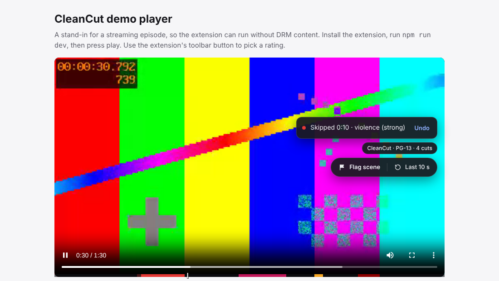
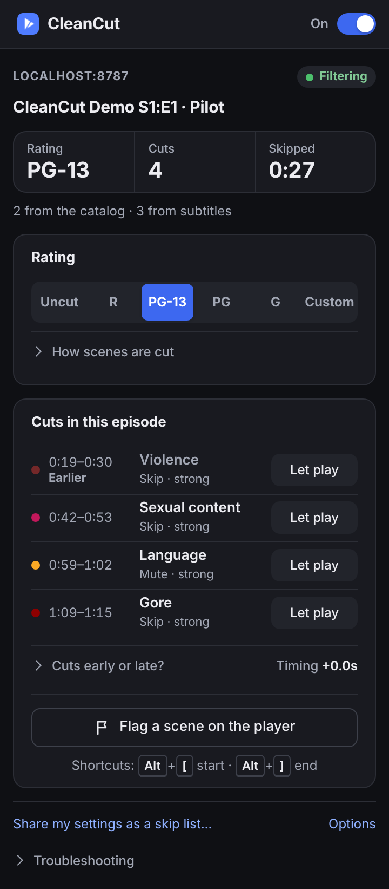
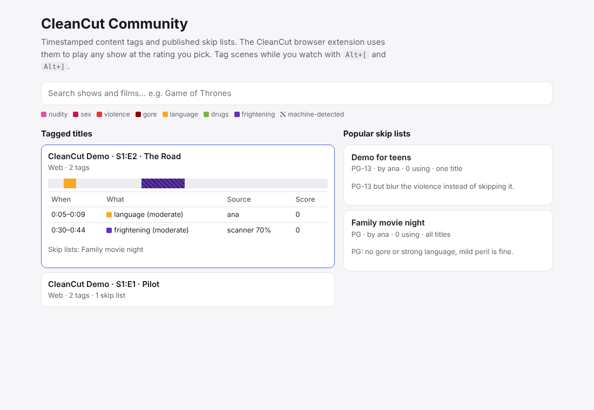

# CleanCut

**Watch any show at the rating you choose.** CleanCut is a browser extension
that runs on top of Netflix and Prime Video (and any page with a `<video>`).
It recognizes what's playing, looks up timestamped content tags, and **skips,
mutes or hides the picture of** the scenes above your chosen rating. Take *Game of Thrones*
and watch an R, PG-13, PG or G cut of it.

It has three parts:

| Part | What it does | Where |
| --- | --- | --- |
| **Browser extension** (Chrome / Edge / Firefox, Manifest V3) | Identifies the title, applies your rating, scans the episode's subtitles ahead of playback, lets you tag scenes while you watch | [`extension/`](extension) |
| **Community server** (Node + built-in SQLite, zero runtime dependencies) | Stores tags, votes, accounts and published skip lists, and serves a small web hub | [`server/`](server) |
| **Scanner CLI** (`cleancut-scan`) | Runs lightweight vision models over video files offline and publishes machine-detected segments | [`scanner/`](scanner) |

<p>
  
  
</p>

They share one core ([`shared/`](shared)): the content taxonomy, the rating
presets, the decision engine, subtitle parsing and the subtitle analyzer.

---

## How it works

```
                 ┌───────────────────────── browser tab (netflix.com / primevideo.com / …) ──────────────────────────┐
                 │                                                                                                    │
 player's own    │  page-hook.js (page world)            content script                                              │
 network calls ──┼─▶ sees manifest / metadata JSON ──────▶ identify title ──▶ lookup ─────────────┐                  │
                 │   fetches full English SDH subtitles ─▶ analyzer: profanity + [sound cues] ─────┤                  │
                 │   Netflix seek bridge ◀──────────────── engine: decide(t) every 100 ms ◀── plan ◀┘                  │
                 │                                          │ skip → seek past   mute → video.muted   hide → dark video │
                 └──────────────────────────────────────────┼─────────────────────────────────────────────────────────┘
                                                            ▼
                                   background worker ──▶ community API (/v1/lookup, /v1/segments, /v1/profiles)
                                                            ▲
                                   cleancut-scan (offline): ffmpeg frames → ONNX classifier → segments ─┘
```

1. **Identify.** Each platform adapter works out what is playing. Netflix uses
   the `/watch/<id>` URL plus the player's metadata response, Prime uses the
   episode ASIN from its playback-resources response, and other sites use
   `<meta name="cleancut:*">` tags or the URL. Each title also gets a
   *canonical key* (`game-of-thrones/s01e01`), so tags made on one platform
   can be offered on another.
2. **Gather segments** from three sources:
   - **Community tags:** humans marked a scene with a category and severity.
   - **Your own tags:** flagged on the player while watching (**Flag scene**, or `Alt+[` / `Alt+]`).
   - **Scan-ahead:** the subtitle track is analyzed the moment the player
     downloads it, before the scenes play (see below).
3. **Plan.** Your profile sets the highest severity allowed per category. Every
   segment above it becomes an action (skip, mute or hide picture). Nearby regions are
   merged so playback doesn't stutter.
4. **Act.** A 100 ms loop compares playback time against the plan and skips,
   mutes or hides the picture. A toast shows what happened, with **Undo**, which lets that
   scene play.

### Ratings

Severity runs from 1 (mild) to 3 (strong). Each preset is the highest severity
allowed to play; anything above it is cut.

| Preset | Nudity | Sex | Violence | Gore | Language | Drugs | Frightening |
| --- | --- | --- | --- | --- | --- | --- | --- |
| R | moderate | moderate | any | moderate | any | any | any |
| PG-13 | none | mild | moderate | mild | moderate | moderate | any |
| PG | none | none | mild | none | mild | mild | moderate |
| G | none | none | none | none | none | none | mild |
| Custom | per-category sliders | | | | | | |

By default, language is **muted** (captions hide too) and everything else is
**skipped**. Any category can be set to skip, mute or *hide picture* instead.
*Hide picture* darkens the video rather than blurring it: a blur filter over a
full-size video stuttered playback badly in testing, while darkening is a
single cheap pass. It is stored as `blur` for compatibility.

### Scan-ahead with lightweight models

Streaming video is DRM-encrypted, so a browser extension **cannot see the
frames**. Drawing a protected video to a canvas gives black. CleanCut therefore
scans in two places:

- **In the browser: the subtitle track.** Netflix and Prime download the full
  subtitle file at playback start. The page hook reads the track list from the
  player's own JSON, fetches the English SDH track, and the analyzer
  ([`shared/analyzer.js`](shared/analyzer.js)) processes the whole episode in
  milliseconds:
  - *Profanity* in dialogue becomes precise mute segments, by line or by
    estimated word timing.
  - *Sound descriptions* in SDH captions (`[moaning]`, `[gunfire]`,
    `[bones crunching]`) and suggestive dialogue become scene hints. Hints of
    the same category are clustered over time, and their confidences compound
    (1 − Π(1 − cᵢ)). Three sex-related cues in ten seconds come out as one
    sex scene at about 83% confidence.

  Machine segments are **suggestions** unless they clear your confidence bar
  (default 60%). The timeline shows them hatched.
- **Offline: the frames.** `cleancut-scan` runs any Hugging Face-style ONNX
  image classifier over a video file you have lawful access to, smooths the
  per-frame scores into scenes, and publishes them to the database as
  `scanner` segments for people to confirm.

---

## Quick start

Requires Node 22.13+ (for the built-in `node:sqlite`) and, for the demo video
and scanner, `ffmpeg`.

```bash
cd cleancut
npm install
npm run build          # → extension/dist/chrome and extension/dist/firefox
npm run demo:video     # generates server/public/demo.webm (ffmpeg)
npm run server         # http://localhost:8787  (hub at /, demo at /demo)
```

**Load the extension**

- Chrome / Edge: open `chrome://extensions`, turn on *Developer mode*, choose
  *Load unpacked*, and pick `extension/dist/chrome`.
- Firefox 128+: open `about:debugging#/runtime/this-firefox`, choose *Load
  Temporary Add-on*, and pick `extension/dist/firefox/manifest.json`. Then
  grant the site permissions from the extension's menu.

**Try it on the demo:** open http://localhost:8787/demo, click **Seed demo
tags**, reload, and press play. At 0:20 the tagged violent scene is skipped.
At 0:44 an *untagged* sex scene is skipped because scan-ahead found it in the
SDH captions. At 1:00 the strong language is muted. Switch ratings from the
toolbar popup and the cut changes. `/demo?mode=hook` serves captions the way
Prime does, through a playback JSON, to exercise the subtitle-fetching path.

**On Netflix / Prime Video:** pick a rating in the popup and play an episode.
If the popup says *subtitles not scanned yet*, turn on **English [CC]** once
so the player downloads the track. You can hide captions again afterwards;
the scan stays.



### Tagging and sharing

- Move the mouse over the player: next to the CleanCut badge on the right is
  **Flag scene**. Click it when a scene starts and **Done** when it ends, or
  click **Last 10 s** to flag what just played. Pick what is in the scene,
  nudge the start and end by a second if needed, and **Save flag**. It applies
  immediately, and the toast has **Undo**. Keyboard: `Alt+[` starts and
  finishes, `Alt+]` finishes (or flags the last 10 s), `Esc` cancels.
  Screenshots: [`docs/flagging/`](docs/flagging).
- Create an account in **Options** to share tags. **Share my unshared tags**
  uploads anything tagged before you signed up.
- **Publish my settings as a skip list…** in the popup shares your rating
  settings, for this title or for everything. Scenes you chose to *Let play*
  become explicit exceptions. Other people see the list in their popup and
  can **Use** it.
- Votes hide bad tags: below a score of −3, a tag is no longer served.

### Scanner

```bash
# subtitle analysis only (SRT, WebVTT, TTML/DFXP)
node scanner/src/cli.js subtitles episode.srt

# frames with a real model (optional dependency onnxruntime-node, installed by npm install)
#   model dir: config.json + preprocessor_config.json + onnx/model_quantized.onnx
#   e.g. https://huggingface.co/onnx-community/nsfw_image_detection-ONNX
node scanner/src/cli.js video episode.mkv --model ./models/nsfw --map nsfw=nudity --subs episode.srt -o scan.json

# frames with the no-model heuristic baseline (scores capped at 50%, so they stay suggestions)
node scanner/src/cli.js video episode.mkv -o scan.json

# publish against the platform's own video id (times must match that encode)
node scanner/src/cli.js publish scan.json --platform netflix --id 70248288 \
  --series "Game of Thrones" --season 1 --episode 1 --key "$CLEANCUT_API_KEY"
```

The quantized NSFW ViT runs at about 8–9 frames per second on a laptop-class
CPU, so a one-hour episode sampled at 1 fps takes about 7 minutes. `--map`
lets any classifier feed any category: a violence or gore model, for example,
with `--map violent=violence`.

---

## API

All JSON. Write calls need `Authorization: Bearer <apiKey>`.

| Method | Path | |
| --- | --- | --- |
| POST | `/v1/users` | `{ name }` → `{ apiKey }` |
| GET | `/v1/lookup?platform=&id=&canonical=` | segments, skip lists, and `borrowedFrom` when timing comes from another platform |
| POST | `/v1/segments` | `{ title: {platform, platformId, series?, season?, episode?, name?}, segments: [...] }` |
| POST | `/v1/segments/:id/vote` | `{ value: 1 \| -1 \| 0 }` |
| DELETE | `/v1/segments/:id` | your own tag |
| GET | `/v1/titles?q=` | browse |
| GET / POST | `/v1/profiles` | search / publish skip lists |
| POST | `/v1/profiles/:id/subscribe` | count a user |

Segment: `{ start, end, category, severity: 1-3, action?: skip|mute|blur, note?, source?, confidence? }`.
Categories: `nudity, sex, violence, gore, language, drugs, frightening`.

Configuration is through environment variables: `PORT` (8787), `HOST`
(127.0.0.1) and `CLEANCUT_DB` (`data/cleancut.db`).

---

## Tests

The browser tests and benchmarks drive Chromium with Playwright, a dev
dependency. Download its browser once:

```bash
npm install
npm run setup:browser   # downloads the Chromium build Playwright drives
```

They also need `ffmpeg` to generate their test videos (`brew install ffmpeg`
on macOS).

```bash
npm test            # 27 unit + API + scanner tests (node:test)
npm run test:e2e    # loads the built extension in headless Chromium against the demo
```

`npm run bench` measures the extension's cost on a simulated Netflix watch page.
It serves a fake `www.netflix.com` locally with Netflix-like traffic, then
compares main-thread script time, style and layout work, and dropped frames
with and without the extension. Add `PROFILE=1` to print the hottest
functions.

`npm run bench:playback` checks playback smoothness while a viewer uses the
controls. It plays a 1080p video on the same fake page with a mock control
bar, moves the mouse and clicks pause and play, and reports janky frames,
input delay (Event Timing), dropped video frames, and style and layout work.
`BROKEN_API=1` simulates Netflix's seek API being unavailable.

`npm run bench:real` measures the extension on the real Netflix site: public
pages (a title page and the home page, no account needed), each loaded cold
and warm with and without CleanCut, traced, and compared on main-thread time,
long tasks, compile and code-cache use, FCP/LCP/load, requests and CPU in
every browser process. `--variants none,full,hook,content` switches the two
page scripts separately, `--ext before=…,after=…` compares builds, `--with`
loads other extensions (an ad blocker, say) in every run, and `--traffic`
replays what a signed-in Netflix page does in the background (the player
prefetching manifests for titles on screen, then opening one) inside the
real page. The header of `test/perf/netflix-real.mjs` lists every option.

`npm run trace -- <file>` summarises a Performance recording made in Chrome
DevTools on the real site (Performance → record → Save profile). It reports
main-thread time per owner (the page, CleanCut, other extensions), long
tasks, frame presentation, input latency, and whether CleanCut skipped, muted
or hid anything during the recording.

The end-to-end test plays the demo episode and checks:

- the community-tagged skip, the scan-ahead skip, mute and unmute, and gore;
- the hide-picture action;
- R, PG-13 and unfiltered producing different cuts;
- Undo and adopting a published list;
- keyboard tagging;
- the page-hook subtitle path;
- that the popup and options pages render without errors.

---

## Limits and honest caveats

- **Not tested against live Netflix or Prime Video.** That needs real
  accounts. The adapters follow the players' current DOM and JSON shapes,
  which change without notice. Every extractor is defensive, and the code
  marks each place that depends on site internals. Expect to maintain
  selectors. Netflix's player fetches its manifests over its encrypted MSL
  transport (`/msl/playapi/…`), so the subtitle list is not readable on the
  network. CleanCut reads it when the player itself `JSON.parse`s the decrypted
  manifest (a shape check on each parsed value, in the page hook). If Netflix
  changes that, scan-ahead on Netflix finds nothing; catalog tags and your own
  tags still work.
- **Netflix seeking** goes through the player's own API, because setting
  `video.currentTime` crashes the Netflix player (error M7375). If Netflix
  changes that API, CleanCut notices the failed seek, says so once, and covers
  skip regions by muting and hiding the picture instead.
- **Prime Video** can offset media time from programme time (and ad breaks
  shift it further). The adapter recalibrates against the on-screen clock
  whenever it is visible, and the popup has a manual **Sync** nudge.
- **Cross-platform timing.** Tags are timed against one platform's encode.
  When a title only has tags from another platform, they are offered with a
  warning and the sync control. Automatic alignment, by matching subtitle cue
  timings between platforms, is the next step (see Roadmap).
- **Subtitle hints are hints.** `[moaning]` can be pain, and plenty of scenes
  have no caption at all. That is why machine segments carry a confidence and
  default to suggestions. People confirming tags is what makes a cut reliable.
- **Seeing a skipped scene's first frames.** The engine acts about 150 ms
  early and pads each region, but the first fraction of a second of a scene
  can show. Use *hide picture* for categories where that matters.
- **Legal.** In the US, the Family Movie Act of 2005 permits skipping and
  muting parts of a film during private home viewing, as long as no altered
  copy is made. CleanCut works that way: it never copies, modifies or
  redistributes the stream. Streaming services' terms of use still apply, and
  rules differ by country. This is not legal advice.
- **Privacy.** The only thing that leaves your browser is the lookup of what
  you are watching (platform and id) sent to the server you configure, plus
  anything you choose to share. Subtitles are analyzed locally and never
  uploaded.

## Roadmap

- Automatic cross-platform sync: store cue-timing fingerprints per title and
  cross-correlate them.
- A hosted server with moderation, reputation-weighted votes and duplicate-tag
  clustering.
- In-browser frame models (onnxruntime-web) for non-DRM sites.
- Adapters for Disney+, Max and Hulu.
- Shareable skip-list links, and following people whose lists you like.
- Non-English lexicons.

## Layout

```
shared/      ratings, engine, subtitles, analyzer, lexicon, sources, identity, validate
extension/   build.mjs, src/{background,page-hook,config}.js, src/content/*, src/popup/*, src/options/*
server/      src/{index,app,db}.js, public/{index,demo}.html + demo captions
scanner/     src/{cli,frames,classifiers,timeline}.js
test/        *.test.js, e2e/extension.e2e.mjs, fixtures/
```
